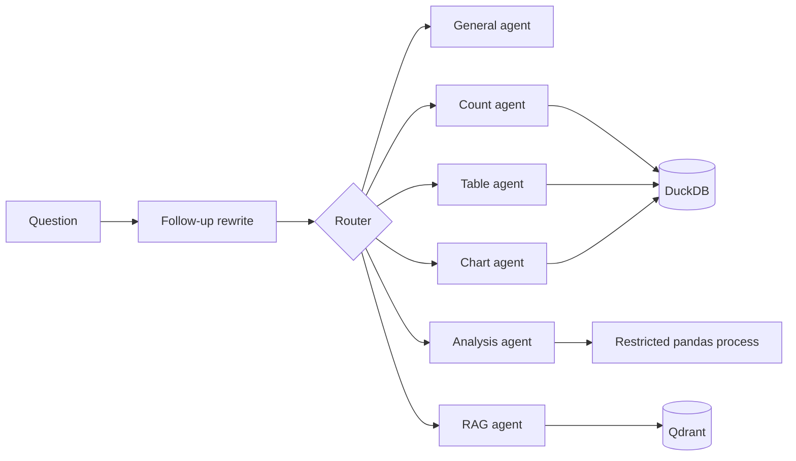

# Jira Ticket Assistant

A chat assistant that answers questions about 59,222 public Apache Jira issues (Kafka, Cassandra, Hadoop). It gives exact numbers for numeric questions, finds tickets by meaning for text questions, cites the ticket keys it used, and is evaluated against answers computed independently in pandas.

Built from scratch on public data. The project is a work in progress; see [Status](#status).

## What it can answer

| Question type | Example | How it is answered |
|---|---|---|
| Counts and metrics | "How many Kafka issues were created in 2023?" | Exact aggregate from DuckDB |
| Lists | "List the 10 oldest unresolved Kafka issues" | Sorted table from DuckDB |
| Charts | "Chart Hadoop issues created per year" | Interactive Plotly chart from DuckDB |
| Calculations | "What percentage of Kafka issues created in 2024 were resolved?" | Model-written pandas code, run in a restricted process |
| Text questions | "Why do consumer group rebalances take so long?" | Semantic search in Qdrant, answer cites ticket keys |
| Anything else | "Who wrote Pride and Prejudice?" | Plain model answer, labelled as not based on the tickets |

Follow-up questions work ("Show that per year as a chart"). Each follow-up is rewritten into a standalone question first.

## Architecture



**Two data layers.** Structured fields (project, type, status, dates, resolution time) live in DuckDB and are answered by exact counting. Ticket text (summary, description, comments) is split into 298,740 chunks, embedded with `BAAI/bge-small-en-v1.5` and stored in Qdrant, with the structured fields attached as filters.

**A router and five agents.** Each agent has a name, a description and a `run(question, context)` method, and is registered in a registry. The router prompt is built from the registry, so adding an agent means adding one file.

**The model never writes SQL for the structured agents.** The count, table and chart agents ask the model for a JSON query plan (filters, group-by, metric). The code validates every column and value against whitelists and then runs the query itself. Resolution-time queries automatically include `valid_for_duration = true`, so invalid durations are never averaged.

**The RAG agent searches twice and merges.** It searches with the full question and with the planner's keyword query, then interleaves the two result lists. A planned project filter is kept only if the project is named in the question. Answers must cite ticket keys; any cited key that was not retrieved is removed.

**The analysis agent runs model-written code, with guard rails.** The code is checked against an AST whitelist (no imports, no file access, no dunder attributes), run in a separate process with a stripped environment and a read-only database, killed after 15 seconds, and limited to 50 result rows. The generated code is shown with every answer. This is a risk-reduction design, not a true sandbox. See [Known limitations](#known-limitations).

**Providers.** One interface over Groq (`openai/gpt-oss-20b`) and Gemini (`gemini-3.1-flash-lite`) with automatic failover. A local Ollama provider exists but its failover path is not tested.

**Logging and history.** Every request gets a trace id with the router decision, agent, query plan, retrieved keys, latency, token counts and errors. Traces are written to `logs/requests.jsonl` and, if configured, to Supabase Postgres together with the chat history.

## Stack

| Part | Choice |
|---|---|
| Vector store | Qdrant Cloud free tier (vectors on disk, int8 quantisation in RAM; measured 369 MiB of 1 GiB) |
| Structured store | DuckDB file |
| Embeddings | `BAAI/bge-small-en-v1.5` (384 dimensions), computed once locally |
| LLMs | Groq and Gemini free tiers |
| Chat history and logs | Supabase Postgres free tier |
| UI | Streamlit and Plotly |

Everything runs on free services. No heavy work runs on the local machine after the one-time embedding step.

## Evaluation

108 questions, all with a ground truth computed independently of the system.

| Set | Questions | Ground truth |
|---|---|---|
| Counts and metrics | 19 | pandas |
| Lists | 9 | pandas (exact order) |
| Charts | 6 | pandas (all values) |
| Calculations | 16 | pandas |
| Text (RAG) | 12 | cited keys checked, answers read by hand |
| Out of scope | 10 | must go to the general agent |
| Retrieval | 30 | each question was generated from one known ticket |
| Unanswerable | 6 | must not invent an answer |

### Latest results

| Metric | Result |
|---|---|
| Routing accuracy | 96.3% (104 of 108) |
| Count exact match | 89.5% (17 of 19) |
| List exact order | 100% (9 of 9) |
| Chart exact match | 100% (6 of 6) |
| Calculation exact match | 100% (16 of 16) |
| Retrieval: right ticket in top 1 / 4 / 10 | 73.3% / 86.7% / 96.7% |
| Retrieval: mean reciprocal rank | 0.807 |
| Right ticket among the sources of the final answer | 76.7% (23 of 30) |
| Unanswerable questions | all 6 answered "the tickets do not mention this" (read by hand) |
| Answers with a cited key that was not retrieved | 3 of 40 (the key is removed) |
| Answers with no citation | 2 of 40 |
| Latency, median / 95th percentile | 2.0 s / 14.6 s |
| Tokens per question, mean | 1,741 |
| Questions that errored | 1 of 108 |

How to read these numbers:

- **The 1 error is a provider failure, not a wrong answer.** For count-016, Groq returned an empty reply and Gemini returned 503 (overloaded) at the same time. The same question was answered correctly in a separate run. An earlier run had more errors because Groq's free daily limit (200,000 tokens) was used up; a full run costs about 170,000 tokens, so it can be run about once a day. Errors count as failures in every metric above.
- **The automatic refusal check is weak.** It is a keyword match and scores 4 of 6. It misses phrasings like "None of the provided tickets mention…". Reading the six answers by hand, all six refuse correctly. It will be replaced by a judge model.
- **Retrieval questions are optimistic.** A language model wrote them from the ticket text, so they resemble the ticket more closely than a real user's question would.
- **The two count failures are not wrong numbers.** One was an errored call and one was routed to the analysis agent, which returned the correct value.
- **Results depend on which provider answered.** Groq answered most questions in the latest run, Gemini most in earlier runs, and the two behave differently.

### What the evaluation found and what changed

The first full run (92 questions) found real bugs. Counts and charts were wrong in places; after the fixes both were exact on that set. The fixes were written after seeing the failures, so those gains are measured on the same questions that exposed the problems.

- Grouped queries returned at most 20 groups, which cut off years. The limit is now 50.
- A question naming a project sometimes ran without the project filter and returned the total. The planner prompt now requires the filter.
- Text questions about a ticket's content were sent to the table agent. The router prompt now sends them to RAG.
- Percentage and ratio questions were answered with plain counts and no error. This gap was found by hand, not by the evaluation, and led to the analysis agent.
- The RAG agent found the right ticket for 70% of the questions that reached it. Comparing four search methods on the same stored plans showed that the planner's keyword query lost details and that a first merge method (rank fusion) pushed good hits out. The final method interleaves the two result lists; on the same plans it finds the right ticket in the top 4 for 24 of 30 questions, against 19 for keywords only.
- The Groq provider returned empty replies for some prompts, and the same request gives the same empty reply at temperature 0. The retry now repeats without JSON mode. One question (count-016) still gets an empty reply from Groq on every attempt, so it fails whenever Gemini is also unavailable.

The calculation set started at 8 of 10 before any prompt change. After two prompt fixes it passed all 16, of which the last 6 were written after the fixes.

### Run the evaluation

```bash
python eval/run_eval.py
python eval/metrics.py
```

`run_eval.py` is resumable and retries questions that errored. Results go to `eval/results/run.jsonl` and `summary.json`; `baseline_run.jsonl` and `baseline_summary.json` are the first run for comparison.

## Known limitations

- **Free-tier limits.** Providers are rate limited and sometimes unavailable. When every provider fails, the user gets an error message, not a guess.
- **Analysis agent risk.** Model-written code can be wrong, and the pandas and numpy attribute surface cannot be proven fully closed. No memory limit is set, because Windows has no simple equivalent of Linux limits. Wrong-but-plausible numbers are the larger practical risk, which is why the code and a label are shown with every answer.
- **Routing.** Two synthetic questions that name no project went to the general agent. Averages and medians are usually handled by the count agent but sometimes go to the analysis agent.
- **The score threshold does not discriminate.** Every retrieved ticket scored between 0.76 and 0.86, relevant or not, so the 0.6 cut-off never fires. Refusals come from the answer model saying the tickets do not cover the topic.
- **Sources under refusals.** The UI lists the retrieved tickets under a refusal, which can look as if they support the answer.
- **Charts** plot counts and averages only, not computed values such as percentages.
- **Privacy.** The text is public Apache content and can contain people's names. Mentions and email addresses are replaced; names in free text are not. Free-tier providers may log prompts, so do not enter confidential data.

## Setup

Requires Python 3.10 or newer, and accounts on Qdrant Cloud, Groq and Gemini. Supabase is optional (chat history and logs).

```bash
git clone https://github.com/Satyam-Satyarthi/jira-ticket-assistant.git
cd jira-ticket-assistant
python -m venv .venv
.venv\Scripts\activate
pip install -r requirements.txt
pip install -e .
```

Copy `.env.example` to `.env` and fill in the values:

```
QDRANT_URL=
QDRANT_API_KEY=
GROQ_API_KEY=
GEMINI_API_KEY=
LLM_PROVIDERS=groq,gemini
DATABASE_URL=
```

Optional overrides: `GROQ_MODEL`, `GEMINI_MODEL`, `OLLAMA_URL`. Use the Session pooler connection string for `DATABASE_URL`; the direct Supabase host is IPv6-only.

### Build the data (one time)

Put the cleaned issue table (59,222 rows, from the companion [Power BI project](https://github.com/Satyam-Satyarthi/jira-ticket-health-dashboard)) at `data/raw/issues_clean.csv`. Set your email in the `User-Agent` in `ingest.py` before fetching.

```bash
python -m ticket_assistant.ingest
python -m ticket_assistant.chunking
python -m ticket_assistant.embeddings
python -m ticket_assistant.vector_store
python -m ticket_assistant.structured_store
```

`ingest` downloads the ticket text (about 15 to 20 minutes, resumable). `vector_store` uploads the vectors to Qdrant Cloud in batches and can be resumed.

### Chat history (optional)

Run this once in the Supabase SQL editor.

<details>
<summary>schema</summary>

```sql
create table sessions (
  id uuid primary key default gen_random_uuid(),
  user_id text not null,
  title text,
  created_at timestamptz not null default now()
);

create table messages (
  id bigserial primary key,
  session_id uuid not null references sessions(id) on delete cascade,
  role text not null check (role in ('user', 'assistant')),
  content text not null,
  agent text,
  trace_id text,
  payload jsonb,
  created_at timestamptz not null default now()
);

create table request_logs (
  trace_id text primary key,
  session_id uuid,
  question text not null,
  agent text,
  latency real,
  prompt_tokens integer,
  completion_tokens integer,
  error text,
  trace jsonb not null,
  created_at timestamptz not null default now()
);

create index on messages (session_id, id);
create index on sessions (user_id, created_at desc);

alter table sessions enable row level security;
alter table messages enable row level security;
alter table request_logs enable row level security;
```

</details>

### Run

```bash
streamlit run ui/app.py
```

The app has a sidebar for the user name, a "New chat" button and past sessions. Answers show tables, interactive charts, source links to the Jira tickets, and a "How this was answered" panel with the query plan or generated code.

### Tests

```bash
pytest -q
```

## Project structure

```
src/ticket_assistant/
    agents/            router targets: general, count, table, chart, analysis, rag
    llm/               provider interface with failover (Groq, Gemini, Ollama)
    ingest.py          fetch ticket text from Apache Jira
    chunking.py        clean and split text into chunks
    embeddings.py      embed chunks locally
    vector_store.py    create and fill the Qdrant collection
    structured_store.py  DuckDB table and exact queries
    planning.py        validate model-written query plans
    retriever.py       semantic search with filters
    generator.py       grounded answers and citation checks
    sandbox.py         restricted execution for the analysis agent
    router.py          chooses the agent from the registry
    follow_up.py       rewrites follow-ups into standalone questions
    history.py         chat history in Postgres
    trace.py           per-request tracing
ui/app.py              Streamlit chat
eval/                  question sets, runner, metrics, results
tests/                 unit tests
```

## Status

Working: the five-agent assistant, the chat UI, history and logging, the evaluation set and runner, unit tests for the code sandbox.

Not done yet:

- More unit tests (query building, filter validation, citation checks)
- Dockerfile and docker-compose for the app
- GitHub Actions workflow (lint and tests)
- Judge-model check of answer faithfulness and refusals
- Governance documents: EU AI Act risk classification, model card, risk register
- A standalone web frontend